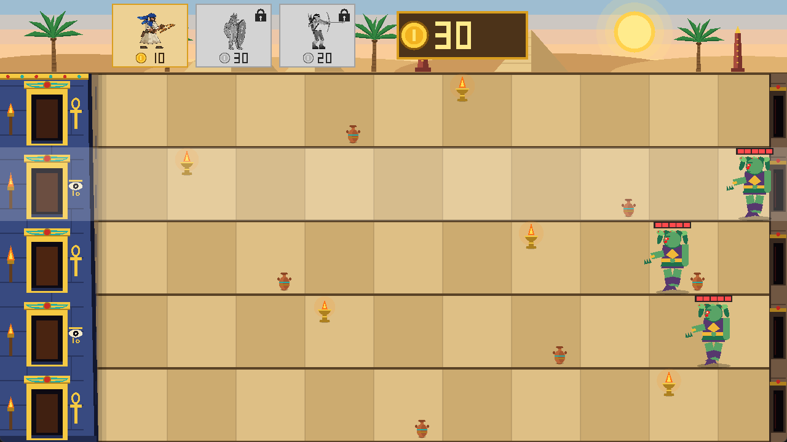
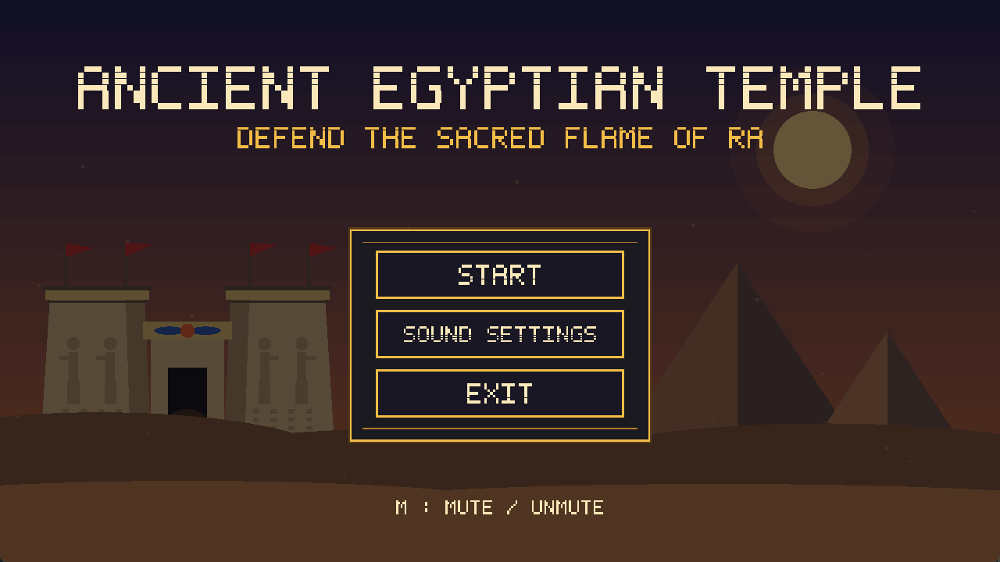
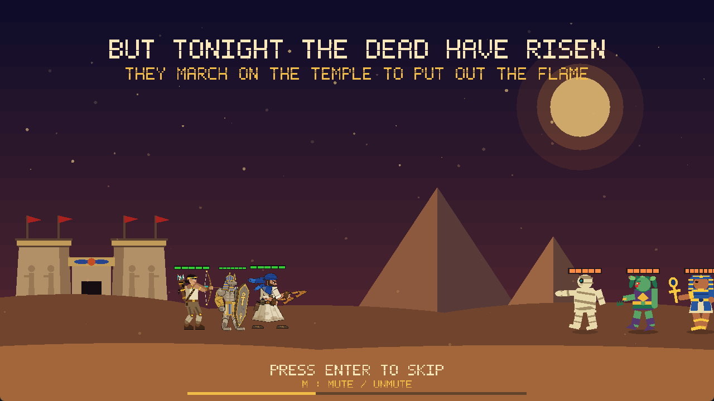

<div align="center">

# 𓂀 Ancient Egyptian Temple

**A lane-defense game written from scratch in C++17 and modern OpenGL — playable in the browser via WebAssembly.**

[](https://faresmoustafa1.github.io/Ancient-Egyptian-temple-game/)
[](https://github.com/faresmoustafa1/Ancient-Egyptian-temple-game/actions/workflows/deploy-web.yml)




</div>

## About

The Temple of Ra guards a sacred flame. Tonight the dead have risen and march on the temple to put it out.
Place warriors in five lanes, collect the treasure that fallen enemies drop, and hold the gate through
three escalating waves of mummies, Medusas and undead pharaohs.

Every character, effect and menu is **drawn procedurally from primitive shapes** with a custom 2D renderer —
there are no sprite sheets or image assets. The only external content is the audio.

<table>
  <tr>
    <td></td>
    <td></td>
  </tr>
  <tr>
    <td align="center"><sub>Main menu</sub></td>
    <td align="center"><sub>Animated intro cutscene</sub></td>
  </tr>
</table>

## Features

- **Three playable warriors**, each with distinct shape, animation and role
  - **Khopesh guard** (melee, 10 coins) — advances and strikes with paired bronze blades
  - **Archer** (ranged, 20 coins) — fires arrows on a fixed rhythm
  - **Temple guardian** (defense, 30 coins) — a stationary shield that absorbs 7 hits, placed anywhere in its lane
- **Three enemy types** with their own attacks — Medusa (eye lasers), Mummy (sand tornado projectile), Pharaoh (lightning)
- **Wave system** — 3, 5, then 10 enemies; a new wave starts only once the field is clear
- **Economy** — defeated enemies drop collectibles; cards stay greyed out until you can afford them
- **Jump / duck** commands for every warrior in the selected lanes to dodge incoming attacks
- **Full game flow** — main menu, sound settings, 17-second animated cutscene, instructions, pause, victory and defeat screens
- **Audio** — looping suspense soundtrack and 13 sound effects with voice pooling, volume and mute
- **Resolution independent** — fixed 1600×900 virtual space with letterboxing at any window size
- **Runs on desktop and in the browser** from the same codebase

## Controls

| Action | Input |
| --- | --- |
| Select a lane (multiple allowed) | Left click on the lane |
| Place a warrior | Select lane(s), then click a card |
| Place the shield | Select a lane, click the shield card, then click a spot in the lane |
| Jump | `W` / `↑` |
| Duck | `S` / `↓` |
| Pause / resume | `Esc` |
| Skip intro | `Enter` |
| Mute / unmute | `M` |

## Tech & architecture

| Layer | What it does | Where |
| --- | --- | --- |
| **Engine core** | Window, main loop, state machine, hook system, input | [`src/core/`](src/core) |
| **Renderer** | 2D shape renderer (rect, circle, ellipse, triangle, polygon) with a push/pop transform stack, GLSL shaders, grayscale mode | [`src/render/`](src/render) |
| **Players** | Three hierarchical, animated character models and combat logic | [`src/*Player.cpp`](src) |
| **Enemies** | Enemy types, attacks, projectiles and wave scheduling | [`src/enemy/`](src/enemy) |
| **Game** | Economy, home base, procedural environment | [`src/game/`](src/game) |
| **UI** | Cards, menus, cutscene, procedurally drawn pixel font | [`src/ui/`](src/ui) |
| **Audio** | miniaudio wrapper | [`src/audio/`](src/audio) |

**Design highlights**

- **Hook-based architecture.** Systems register callbacks (`onGameplayUpdate`, `onDraw(Layer, …)`, `onReset`) instead of the
  engine knowing about them, so players, enemies and UI were developed independently by different team members without
  editing the core loop.
- **Deterministic update order** each frame: engagements → player movement → enemies & waves → collectibles.
- **Hierarchical modelling.** Characters are built from many primitives using a matrix stack, so limbs and weapons animate
  relative to their parent joints.
- **One codebase, two targets.** A tiny platform header ([`src/render/GL.h`](src/render/GL.h)) switches between desktop
  OpenGL 3.3 (GLAD) and WebGL 2 (Emscripten); the main loop hands control to the browser with
  `emscripten_set_main_loop` on the web.

**Libraries:** [GLFW](https://www.glfw.org/) · [GLAD](https://github.com/Dav1dde/glad) · [GLM](https://github.com/g-truc/glm) · [miniaudio](https://miniaud.io/) — all vendored in [`external/`](external).

## Running locally

### Option 1 — Desktop (Windows, Linux, macOS)

**Requirements:** CMake ≥ 3.10, a C++17 compiler (MinGW-w64 / GCC, Clang or MSVC) and optionally Ninja.

> On Windows, `python install_tools.py` downloads MinGW, Ninja and CMake and adds them to your PATH.

```bash
git clone https://github.com/faresmoustafa1/Ancient-Egyptian-temple-game.git
cd Ancient-Egyptian-temple-game

cmake -S . -B build -G Ninja -DCMAKE_BUILD_TYPE=Release
cmake --build build

./build/OpenGLStarter          # Windows: .\build\OpenGLStarter.exe
```

Linux needs the usual GLFW dependencies first, for example on Ubuntu:
`sudo apt install libgl1-mesa-dev libx11-dev libxrandr-dev libxinerama-dev libxcursor-dev libxi-dev`.

**VS Code:** open the folder with the CMake Tools extension, run *CMake: Configure*, then *Build* and *Launch*.

### Option 2 — Web build (WebAssembly)

**Requirements:** the [Emscripten SDK](https://emscripten.org/docs/getting_started/downloads.html).

```bash
emcmake cmake -S . -B build-web -DCMAKE_BUILD_TYPE=Release
cmake --build build-web

# browsers block .wasm from file://, so serve the folder:
python -m http.server 8000 --directory build-web
```

Then open <http://localhost:8000>.

### Tests

```bash
cmake --build build --target CombatLogicTests
ctest --test-dir build --output-on-failure
```

## Deployment

Every push to `main` runs [`.github/workflows/deploy-web.yml`](.github/workflows/deploy-web.yml), which compiles the game with
Emscripten and publishes it to GitHub Pages. To enable it on a fork: **Settings → Pages → Source: GitHub Actions**.

## Project structure

```
├── src/
│   ├── core/        # Game loop, state machine, lanes, input
│   ├── render/      # Renderer, shaders, GL platform header
│   ├── enemy/       # Medusa, Mummy, Pharaoh, wave system
│   ├── game/        # Economy, home base, environment
│   ├── ui/          # Cards, menus, cutscene
│   ├── audio/       # Sound engine
│   └── *Player.cpp  # Melee, long-range and defense warriors
├── assets/audio/    # Music and sound effects
├── tests/           # Combat logic tests
├── web/shell.html   # HTML page for the WebAssembly build
├── external/        # GLFW, GLAD, GLM, miniaudio
└── CMakeLists.txt   # Desktop + web build
```

## Team

Built as a team computer graphics project by
[@faresmoustafa1](https://github.com/faresmoustafa1),
[@eman383](https://github.com/eman383),
[@mernahossamsabra-spec](https://github.com/mernahossamsabra-spec) and
[@3amrobaia](https://github.com/3amrobaia).
